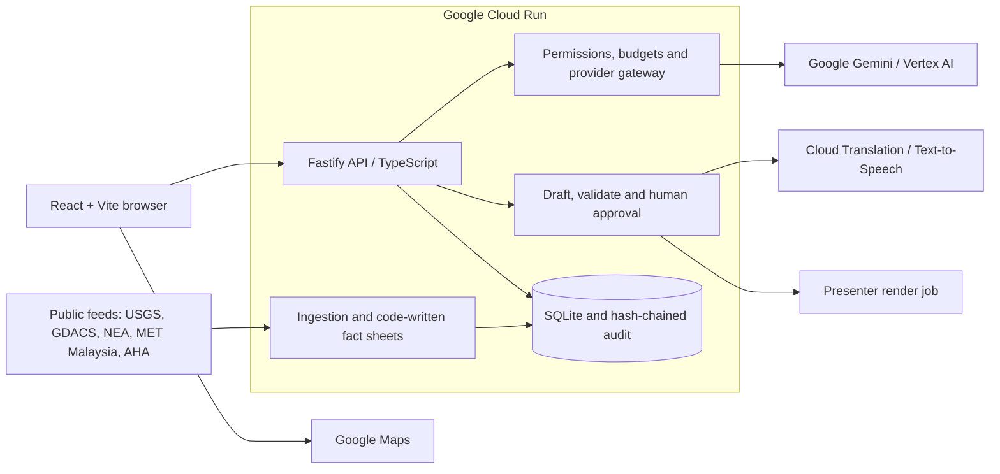

# AEGIS — a safer tomorrow, together

**Evidence-scoped disaster information and human-governed AI communication for ASEAN.**

[Live prototype](https://aegis.walkingwithai.com/assist) · [Demo video](https://youtu.be/y8nBXJLnKXA) · [Judge guide](docs/03-delivery/AEG-BRF-011_judge-guide.md) · [Review status](docs/03-delivery/AEG-QC-001_submission-review.md)

AEGIS brings fragmented public disaster information into one map and workspace. It keeps sources, dates and uncertainty beside incident cards, then helps an authorized operator prepare multilingual communication. **Code owns facts; AI assists with wording; a human approves publication.**

Built for **AI Builder Cup 2026**, under **Sustainability & Social Impact**. This is an engineering prototype, not an operational warning service.

## Try the prototype

1. Open the [public map](https://aegis.walkingwithai.com/assist). Explore country filters, incident cards, nearby places and the historical archive.
2. Choose EN, CN, BM or TA for map labels and available presenter subtitles. The example presenter audio remains English.
3. Sign in with Google to use workspace chat. New accounts accept the terms and privacy notice. Operational tools require Pro/Admin; Admin Desk requires an administrator.
4. Watch the [demo video](https://youtu.be/y8nBXJLnKXA) for the privileged newsroom workflow. No shared judge password or administrator credential is published.

The 17 October presenter bulletin is an **example recording**, not a current emergency warning.

## What is implemented

- **Sourced incident cards and map:** public-feed ingestion, country and hazard filtering, source timestamps and evidence references.
- **Historical archive:** bundled source records, search, timeline and map. Coverage differs by hazard and source.
- **AEGIS Assist:** authenticated chat, budgeted Google model calls, structured cards, and location lookup from stored monitoring/essential-place records.
- **Human-controlled newsroom:** code-written drafts, optional Gemini/Vertex wording suggestions, protected-fact checks, translation, approval and voice/render workflows.
- **Audit and cost controls:** hash-chained decisions, permissions, provider limits and runtime budgets. Private overall spending records remain with operations.

## Google Cloud and AI

Checked **19 October 2026, Malaysia time**: Cloud Run revision `aegis-demo-00060-pet` serves the live site. The page and health endpoint return HTTP 200.

| Integration | Evidence and scope |
|---|---|
| Google-backed Assist | Live provider mode, models and Assist enabled; Google selected as primary. This review did not perform a paid signed-in model turn. |
| Google Maps | Browser integration with restricted browser-key configuration; source also supports an outline fallback. |
| Cloud Translation and Text-to-Speech | Enabled in the deployed configuration. Configuration is not a new end-to-end provider test. |
| Gemini / Vertex script review | Adapter, protected-fact validation and local test coverage are included. Historical measured runs are separate from this review. |
| Cloud Build / Artifact Registry / Cloud Run | Used to build and host the prototype. |
| GPU presenter rendering and BigQuery billing reader | Source integrations are included; no new GPU job or billing query was executed for this review. |

Actual model identifiers, availability and prices depend on the operator's Google project. See the [configuration example](.env.example) and [deployment guide](deploy/README-deploy.md). reAPI is an optional development/backup adapter, not the selected primary on the checked live revision.

## Architecture



The prototype uses SQLite. Hosted storage is ephemeral; durable multi-instance storage and operational resilience remain future work.

## Run from source

Requires **Node.js 22+**, npm and Git. The lockfile pins dependencies.

```bash
git clone https://github.com/jhosenal/aegis-ngo.git
cd aegis-ngo
npm ci
npm run build:ui
npm run dev:api
```

Open **http://127.0.0.1:8787/assist**. The server migrates and seeds a new local database on startup. With no configuration, model calls are off, local fixtures are synthetic, and Google Maps uses its outline fallback. Local preview sign-in is for development only.

For custom configuration, copy `.env.example` to `.env` before starting. In PowerShell use `Copy-Item .env.example .env` and `npm.cmd` if script execution blocks `npm`. Local Admin Desk is at `/admin`; development identities are not hosted credentials.

Live feeds, Google sign-in, Maps, model calls, Translation and TTS each need their own configuration. Paid providers require explicit budgets and keys. Never put server secrets in `VITE_*` variables. See the [judge/developer guide](docs/03-delivery/AEG-BRF-011_judge-guide.md).

## Check the code

```bash
npm run typecheck
npm run typecheck:ui
npm run build:ui
npm test
npm run verify:docs:source
npm run scan:secrets
npm run check:public-files
npm audit
```

The UI build is required before the full test suite. Browser checks use `npm run playwright:install` followed by `npm run test:browser`. Full release QC runs through `npm run ci`; it refuses a production seal when a required check fails. See [review results and outstanding checks](docs/03-delivery/AEG-QC-001_submission-review.md).

## Repository map

| Path | Purpose |
|---|---|
| `src/` | API, ingestion, provider adapters, permissions, budgets and audit |
| `ui/` | React workspace, maps, Assist and Admin Desk |
| `content/`, `fixtures/`, `migrations/` | Content, synthetic fixtures and schema |
| `tests/` | Unit, integration, browser and release-integrity checks |
| `records/sources/` | Public-feed evidence copies used by provenance/hash checks |
| `deploy/`, `render/presenter/` | Cloud deployment examples and render tooling |
| `docs/` | Architecture, engineering notes and review evidence descriptions |

## Limits and licences

Source data may be delayed, incomplete or differently licensed. Unknown information stays unknown; calculated confidence is provisional. Translation requires human review, and protected-number checks do not prove semantic accuracy. Google environmental telemetry is kept separate from emergency declaration evidence.

The public source includes the welcome clip; the hosted 17 October example news assets are not part of this source export. The Judge Trial password backend is not implemented and its form is disabled by default. Never rely on the prototype for emergency dispatch or official warnings.

[MIT](LICENSE) covers AEGIS code. Third-party data, media and models retain their own terms; see [third-party notices](THIRD_PARTY_NOTICES.md). Report vulnerabilities through [the security policy](SECURITY.md).

