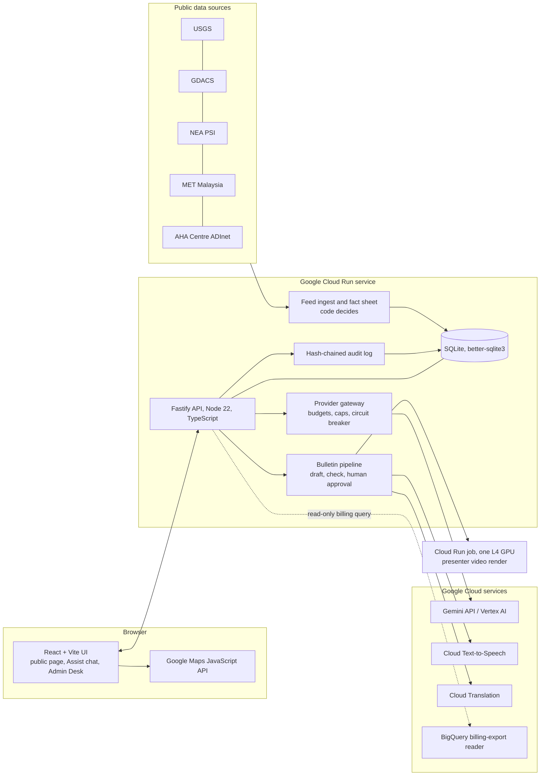

# AEGIS: a safer tomorrow, together

AEGIS turns public disaster feeds into **sourced incident cards** for ASEAN, drafts hourly spoken news bulletins and short emergency alerts, and puts a human administrator between every draft and the public. **Code decides, models speak**: figures, alert levels and checks are computed by code from stored evidence; Gemini helps with wording inside narrow, validated, budgeted limits.

> Prototype for the AI Builder Cup. It is not an operational warning system. Every card names its source and date; anything unknown is shown as unknown.

Repository: [jhosenal/aegis-ngo](https://github.com/jhosenal/aegis-ngo). Hosted preview: [aegis.walkingwithai.com](https://aegis.walkingwithai.com/). Sign-in and feature availability depend on the deployed configuration.

### Hosted status checked 18 October 2026

The hosted service is revision `aegis-demo-00012-qrr`; it runs an older build than the current local source.

| Integration | Current hosted configuration |
|---|---|
| Gemini-backed chat | Models disabled; provider mode is stub |
| Cloud Text-to-Speech and Cloud Translation | Implemented and tested locally; not enabled on the current hosted revision |
| BigQuery billing-export reader | Implemented; no export-table setting on the hosted service. The export table itself was not verified |

The architecture below describes the implemented source design, including integrations that still need hosted rollout. It does not claim every service is live on the hosted preview.

## What it does

- **Live incident map and cards**: USGS earthquakes, GDACS alerts, Singapore NEA PSI, MET Malaysia statements and AHA Centre ADInet reports, each with provenance, retrieval time and licence note.
- **Historical archive**: 2016 to 2026 events (earthquake, flood, storm, wildfire and haze, outbreak, volcano) with year filter, search and map.
- **AEGIS Assist**: an evidence-scoped chat helper with Gemini and backup-provider adapters; see hosted availability above.
- **Admin Desk**: draft, edit, approve or reject bulletins, translate, make voice and request presenter rendering, watch spend and API status, and manage supported feature switches.
- **Audit**: every decision is written to an append-only hash chain with a verifier.

## System architecture



The React frontend calls Fastify for application data and loads Google Maps directly in the browser. The API reads public feeds into SQLite and builds a fact sheet in code before model-assisted wording. Model calls use the provider gateway; server-side service adapters apply their respective budget and quota controls. Supported feature switches are available in Admin Desk; some service-status controls are deliberately locked.

## Tech stack

| Layer | Technology |
|---|---|
| Frontend | React 19, Vite, TypeScript, Three.js, Google Maps JavaScript API |
| Backend | Node.js 22, Fastify, TypeScript (tsx), zod validation |
| Database | SQLite (better-sqlite3) with numbered migrations; audit hash chain |
| AI | Gemini (Gemini API and Vertex AI), reAPI backup model, all behind a budgeted gateway |
| Google Cloud | Cloud Run (service and GPU job), Cloud Text-to-Speech, Cloud Translation, BigQuery billing export, Artifact Registry, Cloud Build |
| Tests | Vitest (unit and integration), Playwright (Chromium) |

## Run it locally

Requires Node.js 22 or newer.

```bash
npm ci
cp .env.example .env   # optional: add keys; leave blank to run with models off
npm run migrate        # create the SQLite database
npm run seed           # load synthetic fixtures
npm run build:ui       # build the React app
npm run dev:api        # http://127.0.0.1:8787
```

Open `http://127.0.0.1:8787/` for the dashboard, `/assist` for the Assist page and `/admin` for the Admin Desk. Without keys, use the schematic fallback map, synthetic fixtures and bundled archive; Google Maps and live providers require their own configuration. Live public feeds are opt-in with `AEGIS_LIVE_FEEDS=true`; Gemini also requires the provider and budget settings described in `.env.example`. Never commit `.env`. In PowerShell, use `Copy-Item .env.example .env` instead of `cp`, and `npm.cmd` if PowerShell blocks `npm.ps1`.

```bash
npm run typecheck
npm test               # unit + integration
npm run test:browser   # Playwright (run npm run playwright:install once)
```

## Deploy

`Dockerfile` builds the Cloud Run image; see `deploy/README-deploy.md`, `deploy/cloudbuild.yaml` and `deploy/service.yaml`. The presenter video job is in `render/presenter/`.

## Honest limits

- Figures are shown as the source published them; AEGIS has not independently verified them.
- Data confidence on the public tiles is a provisional formula.
- Google air and weather values are not used in narration or generated video.
- Licences of some source material are marked unverified on the card.
- Hosted SQLite storage is ephemeral: a restart or redeploy can lose runtime state. Durable operational storage remains pending.
